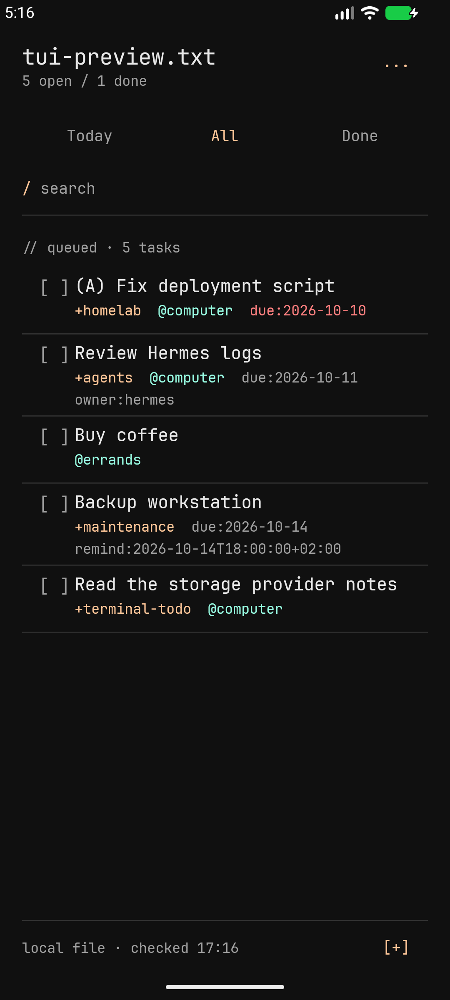

# unticked

A terminal-inspired Android app for your todo.txt. Plain text, bracket checkboxes, and a little less noise.

## What it does

- Complete and reopen tasks with `[ ]` and `[X]`.
- Add tasks and edit their original text.
- Pick priorities, due dates, and explicit reminder times.
- Select between existing `@contexts` and `+projects`.
- Search and switch between Today, All, and Done.
- Undo the last change, with a brief inline action and a shortcut in Settings.



Your file stays a normal todo.txt: no accounts, hidden task IDs, or proprietary task database. unticked has no Internet permission. Use your existing sync tool to share the file between devices.

## Getting started

unticked is currently an early development build. There is no signed release APK; build it from source using Android Studio.

1. Open Settings → Select file and choose your local todo.txt.
2. Tap a checkbox to complete or reopen a task; tap its text to edit.
3. Use `[+]` at the bottom to add a task.
4. Pull down to refresh after changes from another device.

The sample tasks shown before selecting a file are disposable and stay in memory.

## Reminders

Enable Reminders in Settings and allow notifications. Due dates alone do not notify; reminders use an explicit timestamp:

```text
(A) Backup workstation +maintenance due:2026-10-14 remind:2026-10-14T18:00:00+02:00
```

The date/time picker writes the timestamp for you. The task list displays a shorter local-time label such as `remind:tomorrow 18:00` or `remind:14 Oct 18:00`; the file and editor retain the full timestamp. Notifications open the app.

Delivery is approximate and may be delayed by Android battery restrictions. Background checks can discover synced reminders late. The app checks the task again before delivery and suppresses reminders for completed, changed, or ambiguous tasks. If the file is unavailable, the notice says it could not verify the reminder.

## Your text, preserved

unticked preserves untouched lines, spacing, Unicode, and line endings. Edits to dates and priorities leave other fields alone. Unknown `key:value` tokens stay in the file.

Changes from another editor are checked before saving. If the app cannot safely identify a changed task, it keeps your draft. Uncertain writes keep private recovery copies and block further saves until resolved. These checks do not make simultaneous edits atomic; avoid editing the same file in two apps at once.

Current limits: UTF-8 files up to 8 MiB, one task per line, and one explicit reminder per task. Snooze, notification completion actions, and exact reminder timing are not available yet.

## Build from source

Clone this repository and open it in Android Studio. Use the bundled JDK and install the SDK version requested by Gradle, then run the `app` configuration.

To build from a shell with `JAVA_HOME` pointing to Android Studio's JDK and your Android SDK configured:

```sh
./gradlew :core:test :app:assembleDebug :app:lintDebug
```

The debug APK is written to `app/build/outputs/apk/debug/app-debug.apk`.

Development and test details are in [the developer guide](docs/DEVELOPMENT.md). File conventions are documented in [interoperability](docs/INTEROPERABILITY.md).

## Project status and licences

Handset and emulator checks are ongoing. Battery-management behaviour, accessibility, and recovery under interruption still need wider testing.

A project licence and production signing have not yet been chosen. Bundled JetBrains Mono and Vesper include their [third-party notices](docs/notices/).
